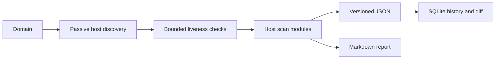

# Teardown

[](https://github.com/ReyemTech/teardown/actions/workflows/ci.yml)
[](https://pypi.org/project/tech-teardown/)
[](https://pypi.org/project/tech-teardown/)
[](LICENSE)


**See what a public web app reveals about its architecture.** Teardown discovers
in-scope hosts, collects frontend and network signals, and writes a versioned
JSON record for agents plus a readable Markdown report. It reports observed
evidence and deterministic findings; interpretation belongs to the reader.

Teardown uses publicly accessible signals. It does not authenticate, exploit,
or test every path mentioned in frontend code. DNS wordlist enumeration is
available only with `--active-dns`.

## Quick start

Requires Python 3.10+. The PyPI package is `tech-teardown`; it provides
`tech-teardown`, `teardown`, and `teardown-mcp` commands.

```bash
# Run without installing into the current environment
uvx tech-teardown example.com --single

# Discover subdomains and scan up to 25 live hosts
uvx tech-teardown example.com

# Machine-readable JSON on stdout; progress stays on stderr
uvx tech-teardown example.com --single --json-only > scan.json
```

You can also `pip install tech-teardown` and run `teardown`. See the
[CLI guide](docs/cli.md) for all modes and options.

## From signals to a report



Each host record can include HTTP and TLS metadata, headers and CSP, technology
detections with confidence and evidence, bundles and source-map inventories,
public API signals, mechanical security findings, and DNS/network attribution.
Geo-IP estimates describe observed IPs, not physical server locations. See
[what the evidence means](docs/collection.md).

An ordinary run writes a JSON and Markdown report under
`~/.teardown/reports/<domain>/`. The report opens with a deterministic summary
and ends with an evidence-backed task list. For example, a source-map finding
points to the exposed map and inventories source paths; it does not claim a
vulnerability from exposure alone. The [output guide](docs/output.md) explains
the JSON contract, local history, cache, and artifact storage.

## Compare scans

```bash
teardown history example.com
teardown compare example.com --days 7
teardown diff last-month.json this-month.json
```

Scans are saved to private local SQLite history by default, including scans
run with `--json-only`. Use `--no-history` to opt out. `--data-dir` or
`TEARDOWN_HOME` changes the data home. Response caching and sanitized
first-party artifact retention can be disabled separately.

## Integrate and extend

`teardown-mcp` serves stdio or local Streamable HTTP. See [MCP setup](docs/mcp.md).
Python integrations can register scan modules; their redacted results appear
under `hosts[].extensions`. See [extensions](docs/extensions.md).

## Documentation and community

The [documentation index](docs/README.md) links the CLI, output, collection,
MCP, extension, development, and licensing guides. Project changes are in the
[changelog](CHANGELOG.md). Contributions are welcome through the
[contribution guide](CONTRIBUTING.md). Please report suspected vulnerabilities
privately as described in [SECURITY.md](SECURITY.md). The project follows the
[Code of Conduct](CODE_OF_CONDUCT.md) and is [MIT licensed](LICENSE); bundled
and optional fingerprint datasets have [separate notices](docs/data.md).
