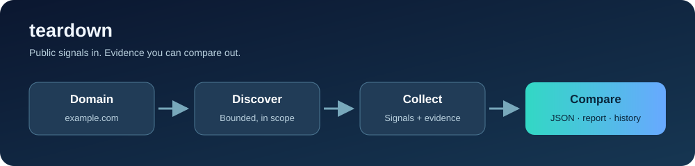

# Teardown

[](https://github.com/ReyemTech/teardown/actions/workflows/ci.yml)
[](https://pypi.org/project/tech-teardown/)
[](https://pypi.org/project/tech-teardown/)
[](https://github.com/ReyemTech/teardown/blob/main/LICENSE)



**Understand what a public web app reveals about its architecture.** Teardown
discovers in-scope hosts, collects frontend and network evidence, and writes a
versioned JSON record for agents alongside a readable Markdown report. It is
a deterministic collector: its findings cite observations, and the reader
decides what those observations mean.

## Quick start

Teardown requires Python 3.10 or newer. The package name on PyPI is
`tech-teardown`; it provides both `tech-teardown` and `teardown` CLI commands.

```bash
# One host, no subdomain discovery
uvx tech-teardown example.com --single

# Passive discovery, liveness checks, and host scans
uvx tech-teardown example.com

# JSON on stdout for a script or agent; progress goes to stderr
uvx tech-teardown example.com --single --json-only > scan.json
```

`uvx` runs the package in an isolated environment. To install it persistently,
use `python -m pip install tech-teardown` and run `teardown`. The complete
command reference is in the [CLI guide][cli].

## What Teardown collects

| Area | Public evidence recorded |
| --- | --- |
| Host discovery | crt.sh, CertSpotter, and Wayback results; optional installed `subfinder` sources |
| Liveness and HTTP | Reachable URL, status and redirect chain, title, TLS details, headers, CSP, and CDN response signals |
| Technology | Framework, CMS, and other fingerprints with evidence and a deterministic confidence score |
| Frontend code | First-party JS bundles, valid exposed source maps, source paths, and referenced API paths |
| API surface | Bounded REST, GraphQL, OpenAPI, and WordPress observations supported by responses |
| Network | DNS A/AAAA and CNAME chain, routed prefix, ASN, registered holder, provider evidence, and approximate Geo-IP |
| Findings | Mechanical security observations with severity, confidence, detail, and evidence URL |
| Changes | Normalized differences between two saved scans or history runs |

Teardown requests publicly accessible material only. It does not authenticate,
exploit, evade defenses, or visit every route found in frontend code. DNS
wordlist enumeration requires explicit `--active-dns`. A referenced API path
is an inventory item, an observed CDN IP can be an edge, and Geo-IP is an
estimate for that IP. The [collection guide][collection] explains these
limits in detail.

## Run a scan

```bash
teardown example.com --single                 # just the given host
teardown example.com --max-probes 40 --max-hosts 10
teardown example.com --subfinder              # add installed passive sources
teardown example.com --active-dns --wordlist words.txt
teardown example.com -v                       # host progress
teardown example.com -vv                      # module and probe progress
teardown example.com --no-history --no-artifacts --no-cache
```

The default cap is 100 liveness probes and 25 live hosts torn down. The HTTP
client limits concurrency and request rate, and identifies itself. `--single`
skips enumeration. Ordinary scans produce two files under
`~/.teardown/reports/<domain>/`:

```text
<timestamped-name>-teardown.json    versioned ScanResult for programs and agents
<timestamped-name>-teardown.md      human-readable evidence and task list
```

The Markdown report starts with a deterministic summary, then shows host
evidence, findings, and a bounded source-map appendix. Local first-party
bundle and map copies are sanitized and size-limited. The JSON contract is
defined in [`teardown/models.py`][models] (currently schema 1.6). See
[output and storage][output] for the field and privacy guidance.

## Compare scans over time

```bash
teardown history example.com
teardown compare example.com --days 7
teardown diff last-month.json this-month.json
```

Completed scans and host checkpoints are saved in SQLite under `~/.teardown`
by default, including scans run with `--json-only`. The same data home holds a
sanitized daily response cache and optional first-party artifacts. Set
`TEARDOWN_HOME` or `--data-dir` to use another directory, or disable individual
stores with `--no-history`, `--no-cache`, and `--no-artifacts`.

## MCP: run with `uvx`

The `teardown-mcp` executable is provided by `tech-teardown`; the `[mcp]`
extra installs FastMCP. Start the stdio server without a persistent install:

```bash
uvx --from 'tech-teardown[mcp]' teardown-mcp
```

Use **that full command** when an MCP client asks for a command and arguments.
The distribution and executable have different names, so `uvx teardown-mcp`
by itself will not select the right package. Pin a package version when you
want repeatable client setups, for example
`uvx --from 'tech-teardown[mcp]==0.6.0' teardown-mcp`.

### Add it to common clients

```bash
# Codex CLI and IDE extension
codex mcp add teardown -- uvx --from 'tech-teardown[mcp]' teardown-mcp
codex mcp list

# Claude Code, available across your projects
claude mcp add --scope user --transport stdio teardown -- uvx --from 'tech-teardown[mcp]' teardown-mcp
claude mcp list
```

For **Cursor**, **Gemini CLI**, or **Claude Desktop**, add this server entry
under `mcpServers` in the client's JSON configuration. Use
`~/.cursor/mcp.json`, `~/.gemini/settings.json`, or Claude Desktop's local
`claude_desktop_config.json`, respectively:

```json
{
  "mcpServers": {
    "teardown": {
      "command": "uvx",
      "args": ["--from", "tech-teardown[mcp]", "teardown-mcp"]
    }
  }
}
```

For **VS Code with GitHub Copilot**, add a stdio MCP server in **Chat: Open
Customizations → MCP Servers**, or place a portable `mcpServers` entry in
`~/.copilot/mcp-config.json`. Include `"type": "stdio"` and
`"tools": ["*"]` in its server entry. The [MCP guide][mcp] has complete,
client-specific steps, configuration locations, status checks, and a
[ready-to-copy JSON example][mcp-example].

MCP scans save SQLite history and sanitized artifacts by default. Append
`--no-history --no-artifacts` after `teardown-mcp` in the startup command to
turn those stores off. The same server also supports Streamable HTTP on
`http://127.0.0.1:8000/mcp`:

```bash
uvx --from 'tech-teardown[mcp]' teardown-mcp --transport http --host 127.0.0.1 --port 8000
```

The tools are `teardown_host`, `teardown_domain`, `enumerate_subdomains`,
`scan_domain`, and `diff_scans`. Domain scans can take longer; use their host
and probe caps for client timeouts. Keep the HTTP endpoint on loopback unless
you provide authentication and transport security.

## Extend and contribute

Scan modules can add deterministic, redacted data under
`hosts[].extensions`. Technology detection uses a bundled MIT fingerprint
database; an optional local community import adds breadth under its own
license. See [extensions][extensions] and [data licensing][data].

Start with the [documentation index][docs]. Contributions follow
[CONTRIBUTING.md][contributing] and the [Code of Conduct][conduct]. Report
vulnerabilities in Teardown through [private security reporting][security].
Changes are recorded in the [changelog][changelog]. The code is [MIT
licensed][license].

[cli]: https://github.com/ReyemTech/teardown/blob/main/docs/cli.md
[collection]: https://github.com/ReyemTech/teardown/blob/main/docs/collection.md
[output]: https://github.com/ReyemTech/teardown/blob/main/docs/output.md
[mcp]: https://github.com/ReyemTech/teardown/blob/main/docs/mcp.md
[mcp-example]: https://github.com/ReyemTech/teardown/blob/main/.mcp.json.example
[models]: https://github.com/ReyemTech/teardown/blob/main/teardown/models.py
[extensions]: https://github.com/ReyemTech/teardown/blob/main/docs/extensions.md
[data]: https://github.com/ReyemTech/teardown/blob/main/docs/data.md
[docs]: https://github.com/ReyemTech/teardown/blob/main/docs/README.md
[contributing]: https://github.com/ReyemTech/teardown/blob/main/CONTRIBUTING.md
[conduct]: https://github.com/ReyemTech/teardown/blob/main/CODE_OF_CONDUCT.md
[security]: https://github.com/ReyemTech/teardown/blob/main/SECURITY.md
[changelog]: https://github.com/ReyemTech/teardown/blob/main/CHANGELOG.md
[license]: https://github.com/ReyemTech/teardown/blob/main/LICENSE
