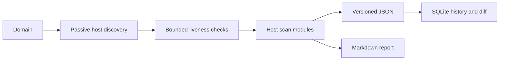

# Development and release

## Architecture



`cli.py` orchestrates scans and output. `enumerate.py` collects in-scope hosts
and liveness metadata. `scan_modules.py` runs independent host collectors over
a shared response and injected `Fetcher`; `http_client.py` owns rate limiting,
scope control, retries, and error responses. `models.py` defines the JSON
contract. `analyze.py` turns signals into mechanical findings, `render.py`
writes JSON and Markdown, `history.py` stores SQLite runs, and `diff.py`
normalizes comparisons. `mcp_server.py` exposes the same scan path to MCP.

Collectors never import `httpx` directly. Network failures are returned as
`FetchResponse` with an error; callers handle them as data. New modules must
keep requests bounded and results redacted. Refer to [extensions](extensions.md)
and [`AGENTS.md`](../AGENTS.md) for coding conventions.

## Verify locally

```bash
python3 -m venv .venv
.venv/bin/python -m pip install -e '.[mcp]' pytest pytest-asyncio build
.venv/bin/python -m pytest -q
.venv/bin/python -m build
.venv/bin/teardown --help
```

Tests use fake fetchers and need no network. CI runs the suite on Python
3.10–3.14, builds a distribution, installs the wheel, and checks both CLI
entry points. When editing workflows, run `actionlint` if installed.

## Release

Use Conventional Commits. On code-bearing merges to `main`, the release
workflow tests and asks Python Semantic Release to version and tag when the
commit warrants it, then builds and publishes through PyPI trusted publishing.
Docs-only merges are filtered out before the release workflow starts. A
`workflow_dispatch` path can republish an existing tag after a failed publish.
See [PUBLISHING.md](../PUBLISHING.md) for the exact process. Do not edit the
version manually.

The dated design documents are historical records and may describe earlier
defaults. The maintained user guides are listed in [the docs index](README.md).
